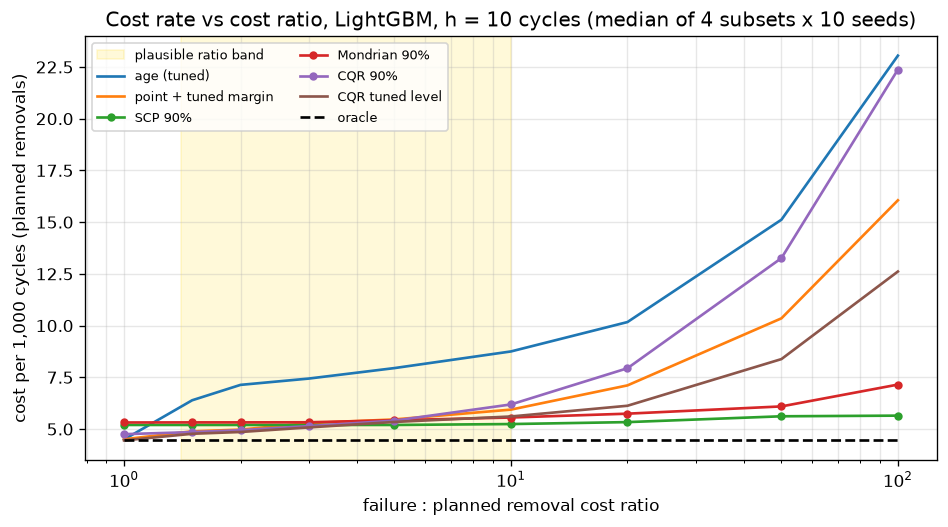
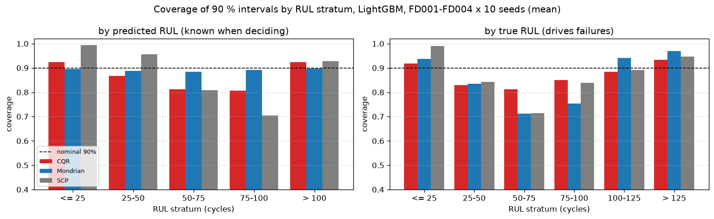
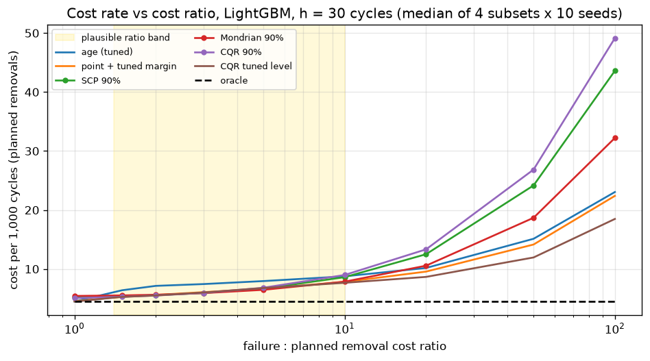
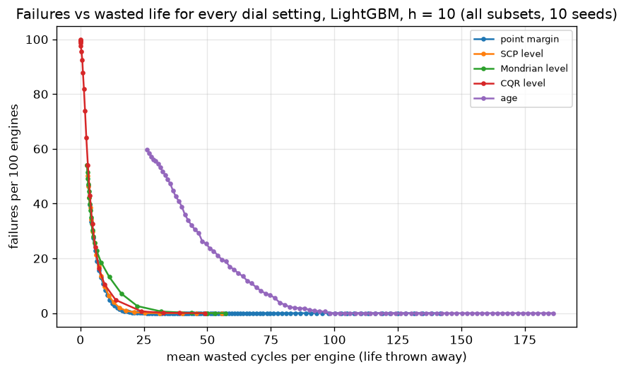

# tfg-rul-uncertainty

**When does uncertainty pay? Prediction intervals, maintenance decisions and the break-even in euros**
*(working title, built on the tutor's feedback of 14 Oct 2026; still to be agreed)*

Bachelor's thesis (TFG). Ana-Maria Angelescu & Rune Snauwaert, Business Intelligence and Data Analytics, La Salle Barcelona, 2026–2027. Tutor: Jonas Viklund.

---

## 0. Status at a glance

| | |
|---|---|
| Question | When is acting on a calibrated prediction interval worth more than acting on a well-tuned point prediction, and from which failure cost (in euros) does it pay off? |
| Engine experiment | Done: FD001–FD004 × 10 seeds, 5-fold engine cross-fitting, so all 709 run-to-failure engines are evaluated once per seed by models that never saw them (`python -m src.run crossfit`) |
| Methods | Linear and LightGBM; split conformal (SCP), Mondrian conformal by predicted-RUL stage, conformalized quantile regression (CQR); 12 maintenance rules incl. age-based replacement, tuned safety margin and perfect information |
| Retail generalisation | Done on synthetic demand (newsvendor, `python -m src.run retail`); real M5 data loader ready, needs the Kaggle files |
| Product prototype | `app/planner.html`: the removal planner (pick the failure cost, see the cheapest rule, move its threshold by hand) |
| Headline | [Key results](#key-results) below; full tables in §8 |
| Next | Agree framing with the tutor; LSTM (H4); M5 run; 4–6 practitioner interviews on costs and on how much override planners need |

---

## Key results

NASA C-MAPSS FD001–FD004, all 709 run-to-failure engines, 10 seeds, every engine predicted by a model that never saw it. LightGBM, 90 % intervals, a planned removal set at €1.0 M. Full tables and caveats in [§8](#8-results).

| Question | What we found |
|---|---|
| Do 90 % intervals cover 90 % at every stage of an engine's life? | **No.** Split conformal covers 99 % of cycles near failure but only 70 % with 75–100 cycles left. Every method is wrong "too late" 11–16 % of the time when 25–50 cycles are left (it should be 5 %). |
| Does calibrating per life stage (Mondrian) fix it? | Partly. It gives 88–90 % in every *predicted* stage, but not the "too late" misses that cause failures. |
| What if the planner acts on the raw prediction? | **53 of 100 engines fail.** |
| And on the prediction plus a tuned safety margin? | A strong baseline, but tuned on few engines it still lets **2–3 of 100** fail. |
| When does acting on a 90 % interval pay off? (10 cycles of notice) | Once an unplanned failure costs more than **≈ 4.4 × a planned removal, about €4.4 M** (half of the 40 runs between €3.2 M and €6.1 M; it breaks even in all 40). No engine fails; it gives up 31 cycles of life per engine instead of 13. |
| And with 30 cycles of notice? | Fixed 90 % intervals let 5–9 of 100 engines fail and rarely pay off. Only a CQR interval with a tuned level still wins in most runs (27 of 40, from about 5 ×). |
| Does the idea work outside aviation? | On synthetic retail demand, yes: an adaptive quantile forecast beats a tuned stock buffer from a stockout : overstock cost ratio of about 1–2. |
| How much can a planner adjust the threshold? | Moving a safety margin by ± 5 cycles costs under 4 %. Moving a confidence level one step riskier costs up to 29 %, one step more cautious at most about 4 %. |



*Cost per 1,000 cycles flown (in planned removals) as an unplanned failure gets more expensive. The shaded band is the plausible range (1.4–10 ×). The tuned safety margin (orange) and the tuned CQR level (brown) are cheapest at low ratios; the fixed 90 % intervals (green, red) stay almost flat and win as failures get dearer; replacing every engine at a fixed age (blue) is the most expensive sensible rule once a failure costs more than a planned removal.*



*Left: by predicted remaining life, which is what the planner sees. Right: by true remaining life, which decides whether an engine fails. The dashed line is the 90 % target.*

---

## 1. How the research question evolved

The question changed several times. Each step happened because the previous version was already published, too big, or not a business question. The thesis keeps the useful part of each.

| # | Question | Why we moved on | What we kept |
|---|---|---|---|
| 1 | *The Living Engine*: an on-board, real-time engine health system | Far too broad for one TFG (tutor) | The motivation: unplanned engine events are expensive |
| 2 | Does deep learning beat simple models on **accuracy** (RMSE) under a fair, leak-free protocol? | Accuracy comparisons on C-MAPSS are everywhere | The protocol: engine-level splits, RUL cap stated, seeds |
| 3 | Which model gives the most **trustworthy intervals**, and is it the most accurate one? | Conformal intervals for engine life on C-MAPSS are published (Javanmardi & Hüllermeier 2023; Robinson 2026) | The conformal pipeline (SCP, CQR) |
| 4a | Marginal coverage hides **where** intervals fail (split conformal over-covers near failure and under-covers mid-life; CQR the opposite) | Kept | **Technical core** (H1–H2) |
| 4b | *(tutor, 14 Oct)* A business thesis starts from the **decision**: price false alarms vs missed failures, sweep cost ratios, report break-even in euros | Kept | **Main thread** (H3) |
| 4c | *(tutor, 14 Oct)* The **framework is the product**: it should transfer to another sector, and planners should be able to adjust it | Kept | Retail test (H5), adjustable threshold (H6), the planner prototype |

**Accuracy (RMSE) is not the object of study.** It is reported, and H4 tests that it is not a sufficient guide.

---

## 2. Research question and hypotheses

**Research question.** Where do conformal prediction intervals for engine life fail to cover, what does that cost a maintenance planner, and above which failure : planned cost ratio does acting on an interval beat acting on a well-tuned point prediction?

| | Hypothesis | Evidence | Status |
|---|---|---|---|
| H1 | A 90 % interval that is valid *on average* misses in specific remaining-life ranges, and the range depends on the method | Coverage by predicted and by true RUL, all engines, 10 seeds, 4 subsets (notebook 06) | Supported (§8.1) |
| H2 | Mondrian calibration by predicted-RUL stage brings each stage near 90 % at a measurable width cost, but does not fix the misses that cause failures (those depend on the *true* RUL) | Same | Supported (§8.1) |
| H3 | A constant-width interval adds nothing beyond a tuned safety margin (it *is* that rule). An adaptive interval beats the tuned margin above a break-even cost ratio, and that ratio depends on how much notice the shop needs | Cross-fitted decision simulation, 9 cost ratios, break-even per seed (notebook 07) | §8.2 |
| H4 | Ranking models by RMSE is not the same as ranking them by decision cost | Linear vs LightGBM now; LSTM to add | Partly (§8.3) |
| H5 | The same framework transfers to retail stocking (newsvendor): a constant buffer ≈ constant-width interval, an adaptive quantile wins above a break-even | Synthetic demand now, M5 next (notebook 08) | Supported on synthetic data (§8.4) |
| H6 | Letting a planner move the threshold a little costs little, so giving control (which raises adoption; Dietvorst et al. 2018) is cheap | Cost of bounded overrides from the threshold curves (notebook 07) + interviews | §8.5 |

---

## 3. What is new, and what we must not claim

Detailed review with sources: [`docs/research_direction.md`](docs/research_direction.md).

**Already published, so not our contribution:** conformal intervals for engine life on C-MAPSS (Javanmardi & Hüllermeier 2023; Robinson 2026; Diao et al. 2026); several model families' intervals (Xu & Zio 2023; Moccardi et al. 2025; BenAbdennour 2026); coverage by remaining-life bin at the final test window (Robinson 2026); "urgent-zone" coverage (BenAbdennour 2026); cost-based maintenance from probabilistic RUL (Mitici et al. 2023; Lee & Mitici 2023; Kamariotis et al. 2024).

**Still open (no peer-reviewed study found):**
1. Coverage along **whole trajectories of every engine**, by predicted *and* true RUL, with the miss direction, instead of ~20 final-window engines per bin.
2. **Mondrian calibration** by predicted-RUL stage, with its width cost, and the evidence that it does not reach the failure-causing misses.
3. Interval-triggered vs **tuned** point-triggered maintenance on the same unseen engines, across cost ratios and notice periods, with the **break-even in euros**. Robinson (2026) lists "maintenance optimization models that explicitly leverage the calibrated prediction intervals" as future work.
4. The same comparison in **retail**, and the **price of planner overrides**.

**Claims to avoid:** "first conformal RUL"; "adaptive intervals were never validated" (Robinson and BenAbdennour did partial checks); "statistically guaranteed coverage" (§5, rule 12); "conditional coverage achieved" (impossible in general; we target chosen strata).

**Risk to check first:** Zhu et al. (2026, *RESS* 267) claim, in the abstract, that an interval-based maintenance strategy beats point-based ones. Read the full text before claiming gap 3.

---

## 4. Data

NASA Prognostics Center of Excellence, *Turbofan Engine Degradation Simulation Data Set* (C-MAPSS, item 6 of the [Prognostics Data Repository](https://www.nasa.gov/intelligent-systems-division/discovery-and-systems-health/pcoe/pcoe-data-set-repository/)). Download: `https://phm-datasets.s3.amazonaws.com/NASA/6.+Turbofan+Engine+Degradation+Simulation+Data+Set.zip` (~12 MB). Citation: Saxena, A., & Goebel, K. (2008). *Turbofan Engine Degradation Simulation Data Set*. NASA Ames Research Center.

| Subset | Train engines (run to failure) | Test engines | Operating conditions | Fault modes |
|---|---|---|---|---|
| FD001 | 100 | 100 | 1 | 1 (HPC) |
| FD002 | 260 | 259 | 6 | 1 (HPC) |
| FD003 | 100 | 100 | 1 | 2 (HPC, fan) |
| FD004 | 249 | 248 | 6 | 2 (HPC, fan) |

`src/load.py` asserts the row and engine counts of all 12 files on every load. The decision analysis uses the 709 **training** engines, because only they are observed until failure; the official test files are truncated.

<details>
<summary>File format and the 21 sensors</summary>

Space-separated text, 26 columns, no header: `unit`, `cycle`, `setting_1..3` (altitude, Mach, throttle resolver angle), `s_1..s_21`.

| Sensor | Symbol | Meaning | Note |
|---|---|---|---|
| s_1 | T2 | Fan inlet temperature | constant (FD001/3) |
| s_2 | T24 | LPC outlet temperature | |
| s_3 | T30 | HPC outlet temperature | |
| s_4 | T50 | LPT outlet temperature | |
| s_5 | P2 | Fan inlet pressure | constant (FD001/3) |
| s_6 | P15 | Bypass-duct pressure | near-constant |
| s_7 | P30 | HPC outlet pressure | |
| s_8 | Nf | Physical fan speed | |
| s_9 | Nc | Physical core speed | |
| s_10 | epr | Engine pressure ratio | constant (FD001/3) |
| s_11 | Ps30 | HPC outlet static pressure | |
| s_12 | phi | Fuel flow / Ps30 | |
| s_13 | NRf | Corrected fan speed | |
| s_14 | NRc | Corrected core speed | |
| s_15 | BPR | Bypass ratio | |
| s_16 | farB | Burner fuel–air ratio | constant (FD001/3) |
| s_17 | htBleed | Bleed enthalpy | |
| s_18 | Nf_dmd | Demanded fan speed | constant |
| s_19 | PCNfR_dmd | Demanded corrected fan speed | constant |
| s_20 | W31 | HPT coolant bleed | |
| s_21 | W32 | LPT coolant bleed | |

</details>

**Retail (H5).** M5 Forecasting – Uncertainty (Walmart, Kaggle; Makridakis et al. 2022). Download `sales_train_evaluation.csv`, `calendar.csv`, `sell_prices.csv` into `data/m5/` (git-ignored) or set `M5_DATA_DIR`. We use the 70 store × department series (M5 level 9). Until then the pipeline runs on a synthetic stand-in (`src/m5.synthetic_sales`).

---

## 5. Protocol: rules that are never broken

1. **Split by engine, never by row.** Rows of one engine are a correlated time series.
2. **Cross-fitting for the decision experiment** (`src/crossfit.py`): engines are shuffled with the seed and cut into 5 folds. For fold *k*: evaluate on fold *k*, calibrate (conformal + rule tuning) on fold *k + 1*, train on the other three. Pooling the five evaluation folds evaluates **every engine exactly once** per seed. The week-1 notebooks use a 70/15/15 split instead (`src/split.py`).
3. **RUL label** = `min(max_cycle − cycle, 125)` (`RUL_CAP`). Decisions use the *uncapped* true remaining life.
4. **Constant sensors are detected** on the training engines (std < 0.01 in every regime), not hard-coded.
5. **FD002/FD004:** settings clustered into 6 regimes (KMeans, fixed seed); each sensor z-scored within its regime.
6. **Everything that is fitted sees training engines only:** scalers, regimes, models.
7. **Features:** z-scored sensors + 10-cycle rolling mean and std per engine.
8. **Seeds 0–9**; every random operation takes the seed explicitly.
9. **No number is typed by hand.** The thesis tables come from `results/*.csv` through `src/summarize.py` and notebooks 06–08.
10. **Conformalise on whole calibration engines.** Engines are roughly exchangeable; rows within an engine are not.
11. **Tuned rules never see the evaluation engines.** Every dial (safety margin, confidence level, replacement age) is chosen on the calibration fold for each cost ratio, then applied once.
12. **Coverage wording.** "Intervals calibrated to a nominal 90 % marginal coverage, verified empirically." The guarantee is marginal and assumes exchangeable calibration and test cases. Because rows within an engine are dependent, it holds only approximately, at engine level. We report the coverage actually achieved, overall and per stratum.
13. **Mondrian strata use predicted RUL, never true RUL** (unknown when the decision is made). True-RUL strata are reported as a diagnostic only.
14. **Decisions are simulated on complete engines**, never on the truncated official test file.

---

## 6. Metrics

| Layer | Metric | Notes |
|---|---|---|
| Accuracy | RMSE (all cycles, true RUL ≤ 50, > 50) | Reported, not optimised (H4) |
| Interval | Coverage, share **below** (alert too late) and **above** (alert too early), mean width, per stratum of predicted and of true RUL | H1, H2 |
| Decision | Failures per 100 engines, wasted cycles per engine | So readers can plug in their own costs |
| Decision | Cost per 1,000 cycles flown (renewal-reward cost rate); **cost index** = cost ÷ perfect-information cost × 100 | Scale-free, comparable across subsets |
| Decision | **Break-even ratio**: the failure : planned ratio above which a challenger stays cheaper than the tuned margin; × €1.0 M = the failure cost in euros | H3; per seed, median and range |
| Decision | Value captured: share of the age-based → perfect-information saving a rule achieves | Business summary |
| Retail | Cost per day, stockout share, fill rate; break-even vs a tuned buffer | H5 |

---

## 7. Decision layer and how to run everything

**Maintenance model** (`src/decision.py`). An engine fails right after its last recorded cycle. A removal needs *h* cycles of notice (10 or 30), so the first alert at cycle *t* books a removal at *t + h*. If the engine is still alive it is a planned removal and its remaining life is wasted; otherwise it fails. Cost rate = (failures × failure cost + planned removals × planned cost) ÷ cycles flown, so throwing life away is never free. The failure : planned ratio is unknown for simulated engines, so it is swept (1, 1.5, 2, 3, 5, 10, 20, 50, 100).

| Rule | Alerts when | Dial |
|---|---|---|
| age (tuned) | cycle ≥ age − h | replacement age; the no-sensor business baseline |
| point | prediction ≤ h | none |
| point + tuned margin | prediction ≤ h + m | m, tuned per ratio: **the honest baseline** |
| SCP / Mondrian / CQR 90 % | lower bound of the 90 % interval ≤ h | fixed |
| … cost-matched | lower bound at level 1 − 2/(1 + ratio) ≤ h | set by the textbook critical ratio (Elkan 2001; newsvendor) |
| … tuned level | lower bound ≤ h | confidence level, tuned per ratio |
| oracle | true RUL ≤ h | perfect information (floor) |

With split conformal the half-width is the same for every engine, so its lower-bound rule *is* the point rule with a fixed margin (tested in `tests/test_decision.py`). An interval can only beat a *tuned* margin if its width adapts to the engine.

**Run the experiments.**

```bash
export CMAPSS_DATA_DIR=/path/to/CMAPSSData          # or put the files in data/raw/
python -m src.run crossfit --subsets FD001 FD002 FD003 FD004 --seeds 0-9    # ~40 min on 2 cores
python -m src.run retail --data synthetic --seeds 0-4                       # ~10 min; --data m5 with the Kaggle files
python app/build_planner.py                                                  # rebuilds app/planner.html from results/
jupyter nbconvert --to notebook --execute --inplace notebooks/06_conditional_coverage.ipynb notebooks/07_decisions.ipynb notebooks/08_retail_generalisation.ipynb
```

`crossfit` appends one block per (subset, seed) to `results/crossfit_{accuracy,coverage,decisions,curves}.csv` and skips pairs already on disk, so an interrupted run resumes (`--force` recomputes). `curves` holds, for every setting of every dial, the failures, removals, wasted and flown cycles on the evaluation engines, so the cost at *any* ratio, and the cost of a manual override, follow without re-running models.

```python
from src import summarize as S
R = S.load()                                                      # the four crossfit CSVs
S.cost_table(R["decisions"], horizon=10)                          # rules x ratios, median over subsets and seeds
S.break_even_runs(R["decisions"], "point + tuned margin", ["SCP 90%", "CQR tuned level"])  # median over runs, euros
S.coverage_table(R["coverage"], by="true")                        # coverage per true-RUL stratum
```

---

## 8. Results

All numbers below: LightGBM unless stated, FD001–FD004 × seeds 0–9, every training engine evaluated once per seed (709 engines × 10 seeds), medians over the 40 subset-seed runs. Source: `results/crossfit_*.csv` via notebooks 06–07. Synthetic engines, so euros illustrate the method; a planned removal is set at **€1.0 M**.

### 8.0 Headline

- **With 10 cycles of notice, a 90 % prediction interval pays off once an unplanned failure costs more than about €4.4 M** (4.4 × a planned removal; half of the 40 runs between 3.2 × and 6.1 ×; the split-conformal interval breaks even in all 40 runs). That is inside the plausible 1.4–10 × band. Below it, a well-tuned safety margin on the point prediction is as good or better.
- **The value of the interval here is a robust margin, not a clever width.** The tuned margin is chosen on 20–52 calibration engines and lets 2.4–3 engines in 100 fail on new engines; a fixed 90 % split-conformal interval lets none fail and wastes 31 cycles of life per engine instead of 13.
- **Adaptive (CQR) intervals with a tuned confidence level break even earliest when they do** (median 2.1 ×), but only in 26 of 40 runs: on the six-condition subsets the quantile models are less reliable.
- **Longer notice changes the answer.** With 30 cycles of notice, fixed 90 % intervals let 5–9 engines in 100 fail and rarely pay off; only a tuned CQR level still breaks even in most runs (27 of 40, median 5.0 ×).
- **The cause is visible in the coverage.** Every method misses on the late side 11–16 % of the time when the true remaining life is 25–50 cycles (nominal 5 %). Mondrian calibration fixes coverage by *predicted* life stage but cannot reach these misses.

### 8.1 Where coverage fails (H1, H2; notebook 06)

Coverage of 90 % intervals by **predicted** RUL (known when deciding), mean over subsets and seeds:

| Method | ≤ 25 | 25–50 | 50–75 | 75–100 | > 100 | Width ≤ 25 / 75–100 (cycles) |
|---|---|---|---|---|---|---|
| Split conformal (SCP) | **0.99** | 0.96 | 0.81 | **0.70** | 0.93 | 45 / 63 |
| Mondrian (per predicted stage) | 0.89 | 0.89 | 0.88 | 0.89 | 0.90 | 19 / 76 |
| CQR | 0.92 | 0.87 | 0.81 | 0.81 | 0.92 | 23 / 71 |

Share of rows with the truth **below** the lower bound (alert too late) by **true** RUL (nominal 0.05):

| Method | ≤ 25 | 25–50 | 50–75 | 75–100 | 100–125 |
|---|---|---|---|---|---|
| SCP | 0.009 | **0.157** | 0.272 | 0.109 | 0.000 |
| Mondrian | 0.047 | **0.114** | 0.238 | 0.208 | 0.003 |
| CQR | 0.071 | **0.139** | 0.142 | 0.099 | 0.031 |

The pattern holds in each subset (notebook 06); the figure is under [Key results](#key-results).

### 8.2 What it costs (H3; notebook 07)

Cost index (perfect information = 100; lower is better) and failures per 100 engines, **10 cycles of notice**:

| Rule | 1.5 × | 2 × | 3 × | 5 × | 10 × | 20 × | Failures /100 at 10 × | Wasted cycles /engine |
|---|---|---|---|---|---|---|---|---|
| Age-based replacement (tuned) | 144 | 164 | 170 | 181 | 203 | 237 | 2.8 | 81 |
| Point prediction, no margin | 128 | 155 | 208 | 315 | 583 | 1119 | 53.1 | 2 |
| Point + tuned safety margin | **108** | **110** | **112** | 117 | 132 | 160 | 2.4 | 13 |
| SCP 90 % | 117 | 117 | 117 | 117 | **117** | **117** | 0.0 | 31 |
| Mondrian 90 % | 117 | 117 | 118 | 119 | 121 | 125 | 0.4 | 32 |
| CQR 90 % | 109 | 111 | 116 | 125 | 147 | 192 | 4.2 | 14 |
| Mondrian, tuned level | 110 | 111 | 114 | 118 | 128 | 143 | 1.3 | 24 |
| CQR, tuned level | **108** | **110** | **112** | **114** | 123 | 143 | 1.7 | 15 |
| Mondrian, cost-matched level | 124 | 140 | 164 | 191 | 155 | 125 | 5.0 | 18 |

Break-even against the tuned safety margin. For each of the 40 runs (4 subsets × 10 seeds): the cost ratio above which the challenger stays cheaper; a run that never breaks even counts as infinite. × €1.0 M = the failure cost in euros.

| Challenger | 10 cycles notice: median (IQR) | runs breaking even | per subset (FD001 / 002 / 003 / 004) | 30 cycles notice: median | runs breaking even |
|---|---|---|---|---|---|
| SCP 90 % | **4.4 (3.2–6.1) = €4.4 M** | **40 / 40** | 4.3 / 6.2 / 2.9 / 3.8 | never | 10 / 40 |
| Mondrian 90 % | 5.5 (3.9–8.0) | 38 / 40 | 4.1 / 7.5 / 4.6 / 5.2 | never | 14 / 40 |
| Mondrian, tuned level | 5.5 (2.8–14) | 31 / 40 | 4.6 / 3.4 / 4.5 / 5.5 | 21 | 20 / 40 |
| CQR, tuned level | 2.1 (0–never) | 26 / 40 | 0 / 3.0 / 0 / 2.1 | **5.0 (1.6–never)** | **27 / 40** |
| CQR 90 % | never | 13 / 40 | 1.7 / never / 1.9 / never | never | 4 / 40 |
| Mondrian, cost-matched level | 12.8 (10.7–16) | 40 / 40 | 10.9 / 16.2 / 11.1 / 15.1 | 27 | 29 / 40 |

Share of runs in which the challenger is cheaper at 10 × (10 cycles notice): SCP 90 % 95 %, Mondrian 90 % 80 %, Mondrian tuned 70 %, CQR tuned 65 %, CQR 90 % 33 %.

How the runs are pooled matters: one break-even computed on the median cost curve over all runs gives 2.7 × for SCP 90 %, because cost rates differ between subsets and a median of raw costs mixes those scales. The thesis therefore reports the distribution of run-level break-evens (`summarize.break_even_runs`).

Why the tuned margin loses at high ratios: on *n* calibration engines it picks the smallest margin that avoided every failure there, and a new engine needs more with probability of roughly 1/(n + 1), which is 2–5 % here. The conformal margin is set by a 90 % quantile over all rows, which near failure is wider than needed (the over-coverage of §8.1), so it trades 18 more wasted cycles per engine for no failures. That trade pays off from about 4.4 × (median run).

The textbook level (critical ratio τ = 1/(1 + ratio)) is too low at moderate ratios: it prices acting early as a whole removal, while under the cost rate it only costs some wasted life. It only competes above 20 ×.



*With 30 cycles of notice the fixed 90 % intervals no longer stay flat: they let 5–9 engines in 100 fail, so their cost climbs with the failure cost.*



*Every setting of every dial, 10 cycles of notice: failures per 100 engines against cycles of life thrown away per engine. Closer to the bottom-left corner is better. All the prediction-based rules sit close together and far below replacing at a fixed age (purple): the sensors are worth a lot; which rule turns them into an alert matters less than how its dial is set.*

### 8.3 Accuracy is not the decision (H4, partial)

LightGBM is more accurate than the linear model (RMSE 18.8 vs 20.4 cycles; 17.6 vs 22.7 near failure). Yet with a 90 % split-conformal rule the linear model is cheaper at 2 × and 5 × (cost index 111 and 115 vs 117), and the linear model's best rule beats LightGBM's best rule in 25 % of subset-seed runs at 5 ×. The ranking holds most of the time but not always; the LSTM will test it properly.

### 8.4 Retail (H5; notebook 08, synthetic demand, 5 seeds)

| Stocking rule | Cost per day at 3 × | 10 × | 50 × | Break-even vs tuned buffer |
|---|---|---|---|---|
| Point forecast | 453 | 1,258 | 5,857 | n/a |
| Point + tuned buffer | 392 | 671 | 1,109 | baseline |
| Constant conformal shift (the retail SCP) | 394 | 671 | 1,120 | in 2 of 5 seeds only (13–21 ×) |
| Conformalised quantile model (the retail CQR) | **385** | **581** | **905** | **1.0 (0–2.2)** |

Same structure as the engines: a constant-width interval is a buffer in disguise, and the adaptive quantile pays off from a low ratio. M5 next.

### 8.5 How much freedom to give a planner (H6)

Extra cost of moving a dial away from its cost-optimal setting (hindsight optimum, all engines, 10 cycles notice):

| Dial (ratio) | 5 steps riskier | 1 step riskier | 1 step more cautious | 5 steps more cautious |
|---|---|---|---|---|
| Safety margin, cycles (2 × / 5 × / 10 ×) | +2.5 to +3.9 % | ≤ +0.3 % | ≤ +0.1 % | +1.2 to +1.5 % |
| Mondrian level (2 × / 5 × / 10 ×) | +13 to +156 % | +1.3 to +11.6 % | +1.5 to +4.2 % | +9 to +18 % |
| CQR level (2 × / 5 × / 10 ×) | +30 to +239 % | +3.3 to +29 % | +0.2 to +2.5 % | +8 to +14 % |

A margin can be left to the planner within ± 5 cycles for under 4 %. A confidence level should move freely towards caution and be capped towards risk. This is the design used in `app/planner.html` and a question for the interviews.

### 8.6 Caveats and choices the thesis must state

- C-MAPSS engines are simulated; cost ratios are assumptions (docs/research_direction.md §5), so results are reported across the whole sweep.
- Tuned rules see 20 (FD001/FD003) or about 52 (FD002/FD004) calibration engines per fold. More history would help the tuned margin; that is part of the finding, since airlines have few run-to-failure histories per engine type.
- The RUL label is capped at 125 and bounds are clipped to [0, 125]; decisions use the uncapped true life. Robustness to the cap is still to do.
- Alerts are checked every cycle; a check every *k* cycles is still to do.
- LightGBM quantile models use `boost_from_average=False` (otherwise the 0.75 model collapsed to a constant 125).
- Week-1 results (FD001, official test, seeds 0–4: LightGBM RMSE 19.5 ± 0.8, 90 % coverage 0.86–0.89) remain in `results/runs.csv` and notebooks 01–05.

---

## 9. Repository layout

```
TFG_BIDA_2026-27_AMA_RS/              # raw data lives OUTSIDE the repo or in data/ (git-ignored)
├── src/
│   ├── config.py        # RUL_CAP, SEED, folds, strata, COST_RATIOS, HORIZONS, PLANNED_REMOVAL_EUR, data lookup
│   ├── load.py          # load_subset(name) -> train, test, rul; asserts counts
│   ├── features.py      # labels, FeaturePipeline (regimes, z-score, constant sensors, rolling)
│   ├── split.py         # 70/15/15 by engine (week-1 notebooks)
│   ├── models.py        # Linear, LightGBM, LightGBM quantile trio
│   ├── conformal.py     # MAPIE v1 wrappers; MondrianSCP; CQRLowerBound (any level, matches MAPIE)
│   ├── evaluate.py      # rmse, nasa_score, coverage, coverage_by_stratum
│   ├── decision.py      # maintenance rules, simulate, cost rate, threshold_outcomes, tune, sweep, break_even
│   ├── crossfit.py      # engine-level cross-fitting -> accuracy, coverage, decisions, curves
│   ├── summarize.py     # euros, break-even per seed, win rates, value captured, coverage tables
│   ├── newsvendor.py    # retail twin of the decision layer
│   ├── m5.py · retail.py  # M5 loader + synthetic stand-in; retail experiment
│   ├── run.py           # python -m src.run crossfit | retail
│   ├── results.py · experiment.py   # week-1 notebook glue (results/runs.csv)
│   └── plots.py         # EDA, interval, coverage-by-stratum, cost-curve, trade-off figures
├── notebooks/           # 01 EDA … 05 seeds (week 1); 06 coverage by stratum; 07 decisions; 08 retail
├── app/                 # planner_template.html + build_planner.py -> planner.html (open in a browser)
├── tests/               # 52 tests: labels, metrics, conformal, decision, cross-fitting, summaries, newsvendor
├── docs/research_direction.md   # literature audit, gap, cost assumptions, behavioural notes, references
├── results/             # runs.csv (week 1); crossfit_*.csv; retail_synthetic_decisions.csv
├── figures/
└── pyproject.toml · requirements.txt
```

---

## 10. Setup

```bash
git clone https://github.com/anaangelescu/TFG_BIDA_2026-27_AMA_RS.git
cd TFG_BIDA_2026-27_AMA_RS
python -m venv .venv && source .venv/bin/activate      # Windows: .venv\Scripts\activate
pip install -r requirements.txt
pip install -e .                                       # makes `import src.…` work from notebooks and tests

# data: unzip the NASA archive into data/raw/ (git-ignored), or keep it next to the repo.
# Lookup order (src/config.py, find_data_dir): $CMAPSS_DATA_DIR -> ./data/raw -> ../data/raw -> ../data/<NASA folder>
python -m src.load --check

pytest                                                 # 52 tests; the one that needs the NASA files is skipped without them
```

`requirements.txt` pins the versions used for the week-1 numbers (Python 3.12, macOS arm64). The cross-fitting and retail results in `results/` were produced with the same pinned package versions on Linux (Python 3.13); LightGBM can differ in the last digits between platforms. This project uses the MAPIE **v1** API (`SplitConformalRegressor`, `ConformalizedQuantileRegressor`, `confidence_level=`).

---

## 11. Roadmap

| Phase | Deliverable | Status |
|---|---|---|
| Pipeline and baselines (FD001) | Notebooks 01–05, tests | ☑ |
| Conditional coverage (H1) and Mondrian (H2) | All engines, 4 subsets, 10 seeds, predicted and true RUL (notebook 06) | ☑ |
| Decision value in euros (H3) | Cross-fitted simulation, 12 rules, 2 notice periods, break-even per seed (notebook 07) | ☑ |
| Product prototype | `app/planner.html` | ☑ v1 |
| Agree framing with tutor | This README + the planner as the demo | ☐ |
| Retail (H5) | Synthetic ☑ · M5 store × department ☐ (needs the Kaggle download) | ◐ |
| Planner overrides (H6) | Cost of bounded overrides ☑ · interviews on how much freedom planners want ☐ | ◐ |
| LSTM and RMSE-vs-cost ranking (H4) | LSTM in the same cross-fitting | ☐ |
| Robustness | RUL cap 130 / uncapped; check-every-k cycles; engine-level bootstrap bands | ☐ |
| Writing and defence | Thesis in the La Salle format, code frozen at a tagged release | ☐ |

---

## 12. Key reading

1. Saxena, Goebel, Simon & Eklund (2008). Damage propagation modeling for aircraft engine run-to-failure simulation. *PHM08*.
2. Angelopoulos & Bates (2022). A gentle introduction to conformal prediction. arXiv 2107.07511.
3. Javanmardi & Hüllermeier (2023). Conformal prediction intervals for remaining useful lifetime estimation. *IJPHM* 14(2). https://doi.org/10.36001/ijphm.2023.v14i2.3417
4. Robinson (2026). RUL estimation for aircraft engines with risk-aware prediction intervals via CQR. *IJPHM* 17(1). https://doi.org/10.36001/ijphm.2026.v17i1.4724
5. Barber, Candès, Ramdas & Tibshirani (2019). The limits of distribution-free conditional predictive inference. arXiv 1903.04684.
6. Vovk (2012). Conditional validity of inductive conformal predictors. *ACML, PMLR* 25; Boström & Johansson (2020). Mondrian conformal regressors. *PMLR* 128.
7. Mitici, de Pater, Barros & Zeng (2023). Dynamic predictive maintenance with probabilistic RUL prognostics. *RESS* 234. https://doi.org/10.1016/j.ress.2023.109199
8. Elkan (2001). The foundations of cost-sensitive learning. *IJCAI*.
9. Makridakis, Spiliotis & Assimakopoulos (2022). The M5 uncertainty competition. *International Journal of Forecasting* 38(4).
10. Dietvorst, Simmons & Massey (2018). Overcoming algorithm aversion: people will use imperfect algorithms if they can (even slightly) modify them. *Management Science* 64(3).

Full reference list and cost sources: [`docs/research_direction.md`](docs/research_direction.md).

---

## 13. Acknowledgements and license

Data: NASA Ames Prognostics Center of Excellence, Prognostics Data Repository; M5 (Walmart, via Kaggle and the University of Nicosia). Code and text: Ana-Maria Angelescu & Rune Snauwaert, La Salle Barcelona, 2026–2027.
